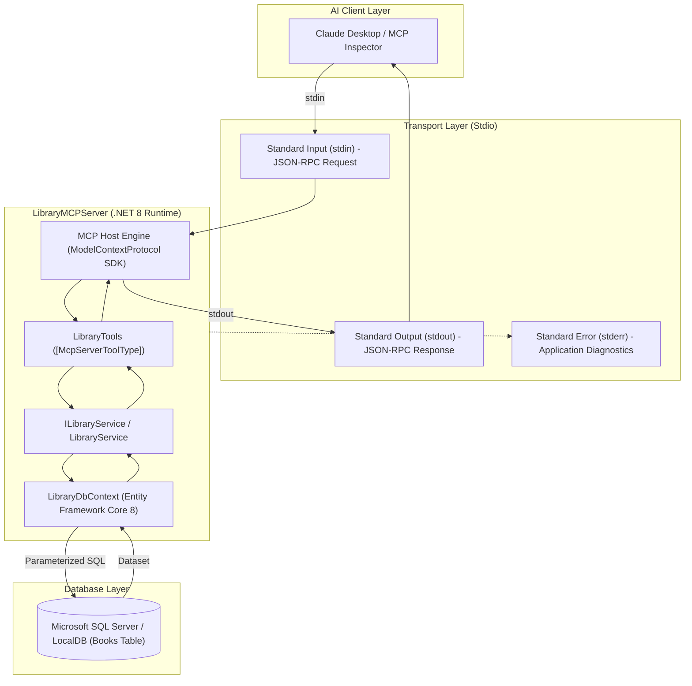
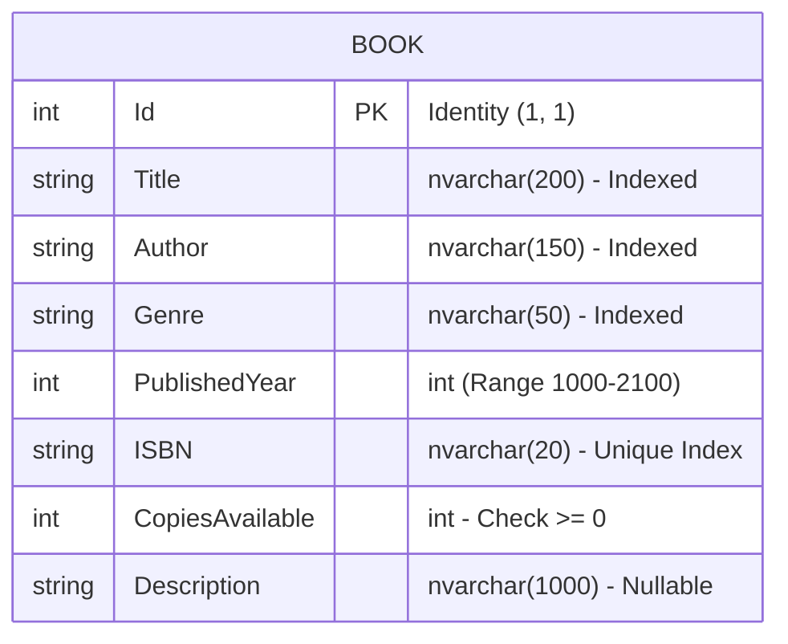

# Architecture Documentation — LibraryMCPServer

## 1. System Overview

`LibraryMCPServer` is a Model Context Protocol (MCP) server built with C# and .NET 8. It allows Large Language Models (such as Claude Desktop or any MCP-compatible AI agent) to query a relational library catalog stored in Microsoft SQL Server without hallucinating records or requiring custom API endpoints.

---

## 2. Model Context Protocol vs. Traditional REST APIs

| Architectural Feature | Traditional REST API | Model Context Protocol (MCP) |
|---|---|---|
| **Consumer** | Frontend apps, microservices, human devs | Autonomous LLMs, AI assistants, agents |
| **Interface Definition** | OpenAPI / Swagger JSON, static contract | Dynamic JSON-RPC 2.0 discovery (`tools/list`) |
| **Transport** | HTTP/HTTPS (stateless request/response) | `stdio` (standard streams) or HTTP SSE |
| **Tool Execution** | Client must write code to call endpoints | LLM chooses tool autonomously based on natural language |
| **Diagnostics** | Mixed in HTTP response bodies / headers | Strictly separated: `stdout` for protocol, `stderr` for logs |
| **Authentication & Boundaries** | API Keys, OAuth tokens, JWTs | Process boundary isolation, local subprocess execution |

---

## 3. Layered Design

### 3.1. MCP Host & Transport Layer
- **Package**: `ModelContextProtocol` (v2.3.1).
- **Transport**: Standard I/O (`stdio`).
- **Standard Output (`stdout`) Isolation**: Critical for MCP reliability. The server clears all default logging providers and configures `ConsoleLoggerProvider` to direct log output exclusively to `stderr` (`options.LogToStandardErrorThreshold = LogLevel.Trace`). This guarantees zero protocol framing corruption.

### 3.2. Tool Discovery & Facade Layer
- **Component**: `Tools/LibraryTools.cs`.
- Uses attributes `[McpServerToolType]` and `[McpServerTool(Name = "...")]` with metadata annotations:
  - `ReadOnly = true`: Signals to AI clients that operations perform no mutations.
  - `Idempotent = true`: Informs clients that repeated calls produce identical side-effects.
- Dependency injection: `LibraryTools` receives `ILibraryService` and `ILogger<LibraryTools>` directly from the DI container.

### 3.3. Application Service Layer
- **Component**: `Services/ILibraryService.cs` and `Services/LibraryService.cs`.
- Enforces business rules, input sanitization, query limits, deterministic ordering, and error boundaries.
- Uses `.AsNoTracking()` on all read operations for minimal memory allocation.

### 3.4. Data Access Layer
- **Component**: `Data/LibraryDbContext.cs`.
- Uses Entity Framework Core 8 with the SQL Server provider.
- Configures database constraints:
  - Unique index `IX_Books_ISBN` on `ISBN`.
  - Non-clustered search indexes on `Title`, `Author`, and `Genre`.
  - Database check constraint `CK_Books_CopiesAvailable` enforcing `[CopiesAvailable] >= 0`.

---

## 4. Entity Schema & Constraints

---

## 5. Seeding Strategy
- **Component**: `Data/LibraryDbSeeder.cs`.
- Powered by `Bogus` with deterministic seed `42`.
- Generates 5,000 realistic fictional records across 10 distinct genres.
- Curated canonical reference entries for George Orwell, Python programming, and Brandon Sanderson to support predictable demonstration prompts.
- Batch inserts (1,000 records per batch) with idempotency check (`!await context.Books.AnyAsync()`).
